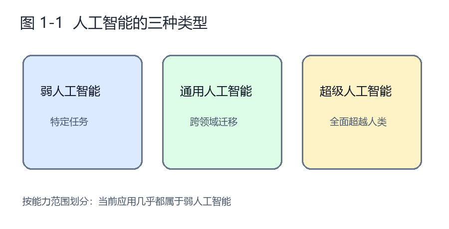
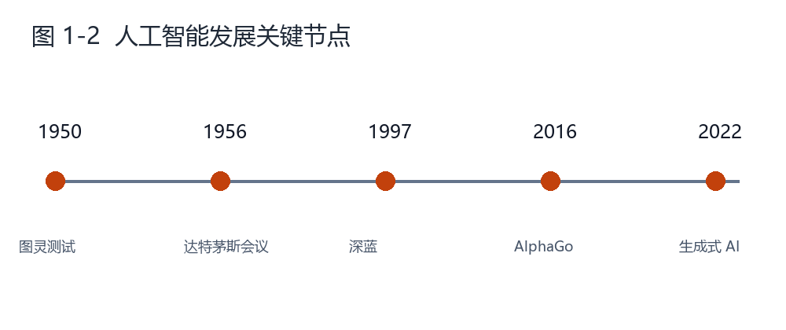

# 第一章 走进人工智能

人工智能已经从一个实验室里的概念，变成了每天都会出现的工具。理解人工智能，既要看到它能做什么，也要理解它是怎样“学会”的，以及它为什么会出错。本章从概念、发展历程和身边的真实应用三个角度，帮助同学们建立对人工智能的初步认识。

## 1.1 什么是人工智能

人工智能（Artificial Intelligence，简称 AI）是研究如何让机器表现出类似人类智能行为的一门学科。这里的“智能行为”通常包括感知、学习、推理和决策。例如，手机能够识别你说的话，摄像头能够识别人脸，导航软件能够根据路况规划路线，这些都属于人工智能的应用。

需要区分“人工智能”和“人类智能”。人类能够理解情境、产生情感、进行价值判断，而当前的人工智能更擅长在特定任务中从大量数据里发现规律。按照能力范围，人工智能通常被分为三类：只能完成特定任务的“弱人工智能”，能够在多个领域迁移的“通用人工智能”，以及理论上全面超越人类的“超级人工智能”。目前我们接触到的几乎都是弱人工智能，例如语音助手、人脸识别和推荐系统。

人工智能并不神秘，它的核心思路可以概括为：从数据中学习规律，再用学到的规律完成新任务。一个识别猫的系统，并不是被人手写“猫有尖耳朵、长尾巴”的规则，而是从成千上万张标注过的图片中总结出特征。这也解释了为什么数据对人工智能如此重要，以及为什么数据中的偏差会影响系统的判断。

## 1.2 从图灵测试到生成式人工智能

人工智能的发展并不是一帆风顺的。1950 年，英国数学家图灵提出了“机器能思考吗”的问题，并设计了著名的图灵测试：如果一个人通过文字与机器交流，无法分辨对方是人还是机器，就可以认为机器表现出了智能。1956 年，达特茅斯会议首次正式提出“人工智能”这一术语，标志着人工智能作为一个研究领域诞生。

早期研究者对人工智能过于乐观，认为只要找到通用的推理规则，机器就能解决所有问题。但现实中的知识往往模糊、复杂，难以全部写成规则。20 世纪 70 年代和 80 年代，人工智能经历了两次“寒冬”，研究经费减少，很多项目停滞。专家系统曾在医疗诊断、故障排查等领域取得成功，但它们依赖人工整理的知识库，维护成本高，遇到新情况容易失效。

转机来自数据和算力的增长。1997 年，IBM 的“深蓝”战胜国际象棋世界冠军卡斯帕罗夫；2016 年，AlphaGo 战胜围棋世界冠军李世石；2022 年以后，以 ChatGPT 为代表的生成式人工智能进入公众视野。生成式人工智能可以根据用户的提示生成文字、图片、代码等内容，但它本质上仍是在预测“接下来最可能出现什么”，并不真正理解自己输出的含义。因此，它可能生成看似合理却与事实不符的内容，这被称为“幻觉”。

## 1.3 人工智能在身边

人工智能已经融入日常生活的许多场景。语音助手把语音转换成文字，再理解用户的意图；短视频和购物平台根据你的浏览记录推荐内容；医院使用医学影像辅助系统帮助医生发现病灶；自动驾驶汽车通过摄像头、雷达等传感器感知周围环境。

这些应用的共同点是：先收集数据，再从数据中提取特征，最后用模型完成分类、预测或生成。以校园垃圾分类为例，系统需要先拍摄大量垃圾图片并标注类别，训练一个能够识别“可回收物”“厨余垃圾”“有害垃圾”“其他垃圾”的模型，再把模型部署到摄像头或手机上。模型识别得准不准，取决于训练数据的数量、质量和多样性。

人工智能也带来新的问题。推荐算法可能让人只看到自己感兴趣的内容，形成“信息茧房”；人脸识别可能涉及隐私；训练数据中的偏见可能让系统对某些群体不公平。技术本身没有好坏，关键在于人如何设计、使用和监管它。学习人工智能，不仅要学会用工具，更要学会判断工具何时可信、何时需要人来复核。

# 第二章 机器如何学习

要让机器完成一项任务，通常需要数据、算法和算力三个要素。本章以一个“识别校园植物”的任务为例，介绍数据、特征、标签的含义，监督学习的基本流程，以及如何评估一个模型是否可靠。

## 2.1 数据、特征与标签

数据是机器学习的原料。在“识别校园植物”的任务中，数据可以是一张张植物照片，也可以是对植物叶片长度、宽度、颜色等属性的测量记录。特征是用来描述对象的特点，例如叶片的形状、边缘是否有锯齿、叶脉的分布方式。选择好的特征，能够显著降低学习难度。

标签是我们要预测的答案。对于分类任务，标签是类别名称，例如“银杏”“香樟”“桂花”；对于回归任务，标签是一个连续数值，例如根据叶片长度和宽度预测叶面积。训练数据由“特征”和“标签”共同组成，模型通过学习特征与标签之间的关系，形成预测能力。

数据质量直接影响模型效果。如果照片模糊、标签标错，或者样本只来自校园的一个角落，模型就可能学到错误的规律。收集数据时要注意代表性、平衡性和准确性：每个类别都要有足够多的样本，不同光照、角度和背景都要覆盖，标签要由多人核对。

## 2.2 监督学习的基本过程

监督学习是最常见的一类机器学习方法。它的基本过程包括：准备带标签的数据、把数据分为训练集和测试集、选择模型、训练模型、评估模型、调整参数，最后部署模型。训练集用于让模型学习规律，测试集用于检验模型面对没见过的新样本时的表现。

以植物识别为例，我们可以把 80% 的图片作为训练集，20% 作为测试集。模型在训练集上不断调整内部参数，使预测结果接近真实标签。训练完成后，用测试集计算准确率：如果 100 张测试图片中有 85 张预测正确，准确率就是 85%。需要注意的是，训练集上的高分并不代表模型真的学会了，如果模型只是“记住”了训练样本，遇到新图片就会表现很差，这种现象称为“过拟合”。

为了避免过拟合，可以采用增加数据、简化模型、正则化等方法。交叉验证也是一种常用手段：把数据分成若干份，轮流用其中一份做测试，其余做训练，最后取平均结果。模型评估不能只看准确率，还要看精确率、召回率等指标。例如在疾病筛查中，漏诊的代价很高，就需要更关注召回率。

## 2.3 模型评估与负责任地使用人工智能

一个模型被训练出来，并不意味着可以直接投入使用。我们还要问：它在哪些情况下可靠？它的错误会带来什么后果？谁对错误负责？在校园植物识别任务中，如果模型把有毒植物误判为可食用植物，后果可能很严重，因此系统必须保留人工复核环节。

评估模型时，要使用与训练数据分布一致、但从未参与训练的测试数据。还要关注不同类别、不同场景下的表现，避免“总体准确率很高，但某一类几乎全错”。对于涉及个人隐私的数据，应遵循最小必要原则，能不用就不用，必须使用时要做脱敏处理。

人工智能是辅助工具，不是替人做决定的“权威”。在使用生成式人工智能时，要核对它给出的事实、数据和引用；在使用推荐系统时，要主动寻找不同来源的信息；在设计人工智能应用时，要考虑公平、隐私和安全。负责任的创新，既包括把技术做好，也包括把技术用好。
