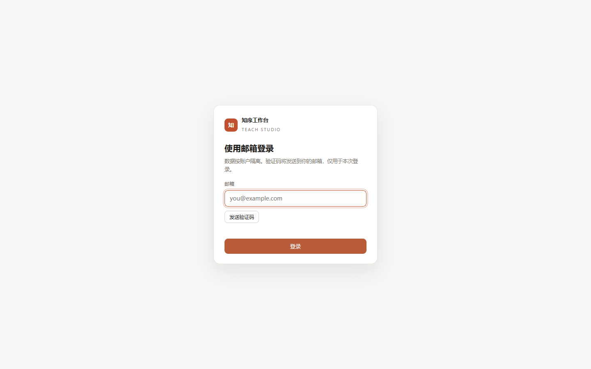
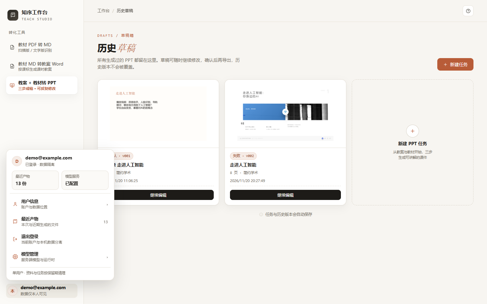
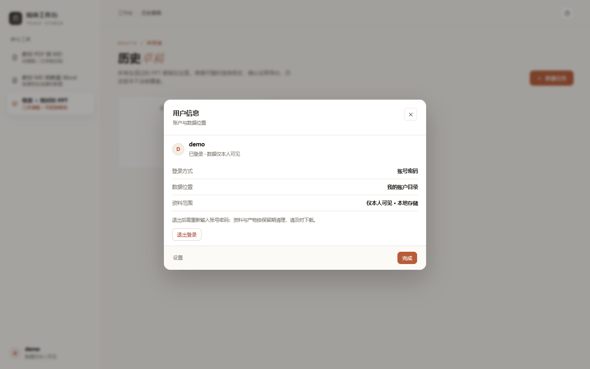
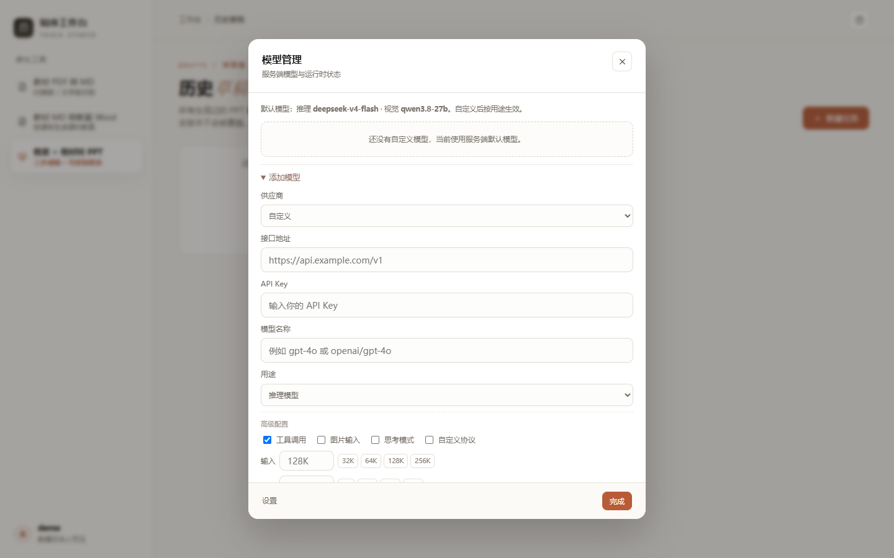

# 作品说明文档（readme/）

| 文档 | 内容 |
|---|---|
| [01-环境依赖与安装.md](01-环境依赖与安装.md) | 运行环境、依赖清单、一键安装、配置与自检 |
| [02-部署与运行.md](02-部署与运行.md) | 开发/生产运行、账号与数据、备份、端口与升级 |
| [03-开源组件说明.md](03-开源组件说明.md) | 使用的开源组件、版本、许可证与边界 |
| [04-码道应用总结.md](04-码道应用总结.md) | 码道在需求、实现、排障、验收中的使用与反思 |

## 作品速览

- 形态：本机运行的 Windows 教学工作台（Flask + 原生前端），含三条链路：教材 PDF→MD、MD→教案 Word、教案+教材→原生 PPT。
- 账号：用户名 + 密码登录，按账号隔离数据（`data/users/<uid>/`）；用户信息弹窗可退出登录。
- 模型：支持为每个账号添加 OpenAI 兼容的推理/视觉模型，未配置时使用服务端默认模型。
- 演示：`project/demo/run_demo.ps1` 一键建演示账号与示例任务并启动。
- 约束：PPT 逐页预览与文字边界质检依赖 Windows 桌面 PowerPoint；Linux 无此能力，项目不宣称跨平台。
- 质量：`python -m pytest -q` 当前 **98 passed, 1 skipped**。

## 界面截图

| 登录 | 账户与隔离 |
|---|---|
|  |  |

| 用户信息与退出 | 模型管理 |
|---|---|
|  |  |
